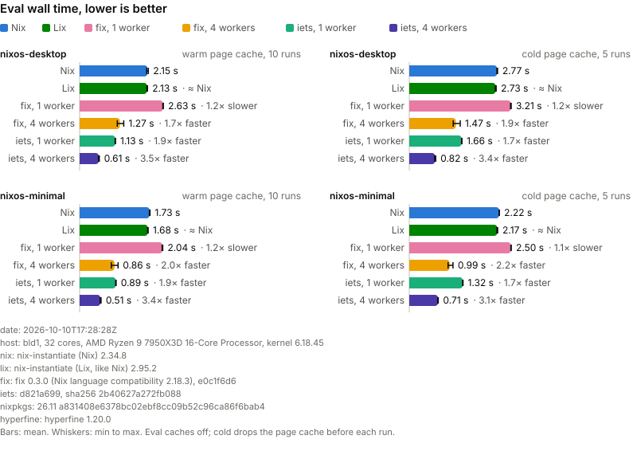

# iets - faster Nix

> *something* that evaluates *nothing*

Maintainer: [zimbatm](https://github.com/zimbatm)

iets is a re-implementation of the Nix client in Rust. Its design comes from
more than a decade of use of the language, and from how the community and
customers use it.

iets is [mostly, but not fully](docs/reference/divergences.md) compatible
with Nix. It also explores new ideas, and tries to reduce the number of tools
you need to use Nix every day.

```sh
iets build -A hello ./nixpkgs                  # nix-build
iets build .#checks                            # nix-fast-build
iets eval-jobs --flake .#hydraJobs             # nix-eval-jobs
iets search -I nixpkgs=./nixpkgs ripgrep       # nix search
iets diff -A hello -A figlet ./nixpkgs         # nix-diff; --closure is nvd
iets prefetch --unpack https://ftp.gnu.org/gnu/hello/hello-2.12.1.tar.gz # nurl, nix-prefetch
iets print-dev-env --gc-root .direnv/env .     # nix-direnv's `use flake`
```

## Features

Some of the ideas that went into iets:

* **Fast eval, and it tells you what it is doing.** Many beginners hit Ctrl-C
  because they think Nix is stuck. Nix was only slow to evaluate, and it gave
  no feedback. iets evaluates NixOS configs 1.5-1.8x faster than Nix 2.34.8 on
  one core, and 3.3-5x faster on four (see [Benchmarks](#benchmarks)). It
  also tells you what it does while it works.

* **Hash bumping that bumps itself.** Bumping FODs (fixed-output derivations)
  means putting a bad hash, running a build, and then replacing the errored
  hash with the right one. iets detects the error, fixes the hash in your
  source, and builds again. See
  [docs/how-to/fix-hashes.md](docs/how-to/fix-hashes.md).

* **Purity without flakes.** Nix eval should be pure by default, with or
  without flakes, so that the language follows its own principle of purity.
  iets supports flakes too. Its introspection tools detect when impurities
  leak into evals or builds. See
  [docs/reference/lints.md](docs/reference/lints.md).

* **Eval caching everywhere.** The cache traces the files an eval reads, so
  it works on all evals. It is more precise than the flake eval cache of Nix.
  `nix fmt` through iets feels instant.
  See [docs/explanation/caching.md](docs/explanation/caching.md).

* **No local store needed.** A single binary for your CI environment, that
  pushes the builds to a Nix daemon or a remote builder over `ssh-ng://`
  (for example https://nixbuild.net) or
  [`grpc://`](https://github.com/Mic92/nix-grpc-store). See
  [docs/how-to/build-remotely.md](docs/how-to/build-remotely.md).

* **A drop-in.** Call it as `nix`, `nix-build`, `nix-shell` or
  `nix-instantiate` and it behaves like that command. Whatever it doesn't
  implement goes to the real `nix`. See
  [docs/reference/classic.md](docs/reference/classic.md).

* **Made for scripts and agents.** Every command speaks JSON, has stable exit
  codes, and errors come with a code, a position and often the fix. See
  [docs/how-to/script-iets.md](docs/how-to/script-iets.md).

* **The evaluator knows where code came from.** It records the source of each
  piece of Nix code. Thus you can enable or disable language features per
  "package", and the language can change one package at a time.

* **Errors that point at your source** (experimental). iets also records which
  source made each drv. When a build fails, it can show where the error came
  from in your source, not in `/nix/store`. This works only sometimes and
  needs more work. See
  [docs/explanation/provenance.md](docs/explanation/provenance.md).

## Benchmarks

<picture>
  <source media="(prefers-color-scheme: dark)" srcset="bench/results/eval-dark.svg">
  
</picture>

To regenerate, run `bench/run.nu nixos-plasma nixos-server nixos-minimal` twice
(once with `COLD=1`), with `LIX` and `FIX` set to the binaries, then
`bench/chart.nu --pins bench/results/env.txt bench/results/*.json`.

## Scope

For now, iets is only a client. It has no nix-daemon implementation. It aims for a good
user experience with no setup, and for fewer tools in daily Nix use. It does
not try to bundle every tool.

## Not supported (yet)

Some things iets doesn't do. In classic mode, most of these fall
back to the real `nix`, so you mostly won't notice.

* No nix-daemon, and no store of its own. Builds go to a daemon or a remote
  builder.
* Flakes have to be local and locked. No registry refs like `nixpkgs#hello`,
  no remote roots like `github:NixOS/nixpkgs#hello`, and no `nix flake
  lock`. Remote *inputs* in a `flake.lock` are fine.
* `fetchGit` copies a local working tree, or a local repo at a `rev` or `ref`,
  by itself. Remote git fetches and git flake inputs run the real `nix`.
* No import-from-derivation (IFD).
* `fetchurl` and `fetchTarball` need a `sha256`. No `fetchClosure` or `hg`
  fetching.
* Only a handful of `nix` subcommands are native. The rest run the real
  `nix`.
* The library never frees memory, so don't embed it in a long-running
  program yet.
* Many other small details. iets is still new.

The full list is in
[docs/reference/classic.md](docs/reference/classic.md#fallback-rules) and
[docs/reference/divergences.md](docs/reference/divergences.md).

## Project status / LLM-ware

This project is LLM-ware. Which is a very different way to write software than the traditional way.
Traditionally we would write everything from the ground up.
Designing the architecture.
Picking the right libraries.
When done rigorously, we would get a sense of if a project is done well or not.

With LLMs it's top-down.

I spent a lot of time verifying the outputs, which is pretty easy to do with
Nix. And poked at the architecture in different angles. But the insides of
the project are not 100% understood by me. And not necessarily the most
pleasing to read. At some levels, the software is of better quality than if I
had written it by hand. And then in others, there could be gaping holes the
LLM pretended was fine, because I didn't prompt it correctly.

How to get to a level of craft that makes me proud is still an open question
for me. And I think the best way to find out is to lean into it.

## Installation

From the flake:

```sh
nix run github:numtide/iets -- version    # run it once
nix profile add github:numtide/iets       # keep it on your PATH
nix build github:numtide/iets#static      # one static binary
```

Or build it from source:

```sh
nix develop -c cargo build --release
./target/release/iets eval --strict -E '1 + 1'
./target/release/iets help
```

On NixOS, import `nixosModules.default` and set `iets.classic.enable = true`.
That puts the classic mode commands (`nix-build`, `nix-shell`, ...) ahead of `nix` in
your path. If direnv is enabled, `use flake` goes through iets too.

## Documentation

`./docs` is LLM-generated, but it should be useful as reference. Start with
[docs/tutorial/getting-started.md](docs/tutorial/getting-started.md). The
binary also carries the reference docs, so `iets help TOPIC` works from
anywhere. [ARCHITECTURE.md](ARCHITECTURE.md) is the map of the code.

## Credits

* All the computer scientists and OSS developers whose output was used to
  train the models.
* The agents also looked at code from [Nix](https://github.com/NixOS/nix),
  [fix](https://github.com/psyclyx/fix) and
  [Determinate Nix](https://github.com/DeterminateSystems/nix-src) when
  comparing for speed.

## Licence

LGPL-2.1-or-later, like Nix (see COPYING). Some files are copied from Nix
(corepkgs, `call-flake.nix`, `get-env.sh`, the `tests/lang` suite) under the
same licence. `proto/nix_remote.proto` comes from Mic92/nix-grpc-store, under the MIT
licence.
